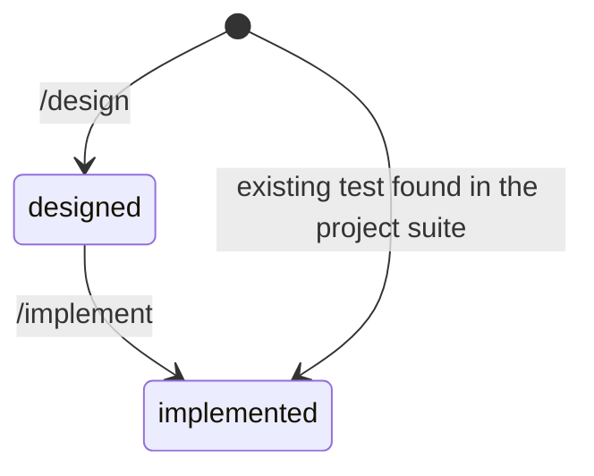
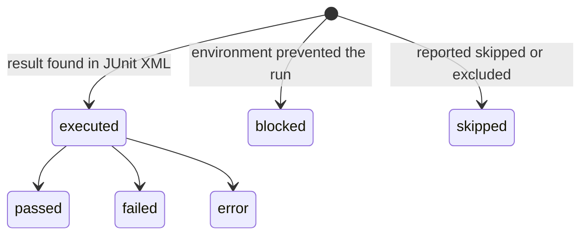

# Test states

RetroAgent separates three facts that are easy to blur: a test was **designed**, a test was **executed**, and a test **passed**. This document explains why the separation exists, where each state lives and who is allowed to set it.

## Why it matters

A language model can write "the tests were run and all of them passed" without any test having run. It can produce test code and describe its expected outcome as if it had been observed. In a testing tool, that confusion is not a cosmetic error: it turns a design into a false quality claim.

The project brief states the condition directly: the agent must distinguish a designed test, an executed test and a passed test, and must never claim it executed a test when it only generated code or described what should be done.

RetroAgent does not rely on the model to respect this rule. The rule is built into the data model and into which component may record each state (ADR-0006, ADR-0016).

## Three questions, three levels

| Question | Answered by | Lives in |
|---|---|---|
| Is the test designed? | Test case `status` is `designed` or `implemented` | Test case |
| Was it executed? | A test execution with `status` `executed`, in a run with evidence | Test execution |
| Did it pass? | That test execution has `result` `passed` | Test execution |

Each question is answered at a different level, and each positive answer requires the previous one: there is no result without an execution, and no execution without a test case.

## Test case life cycle

A test case describes what to verify. Its life cycle does not depend on any run.

| Status | Meaning |
|---|---|
| `designed` | The specification exists: objective, preconditions, input data, steps, expected result, priority and traceability. There is no code. |
| `implemented` | Executable test code exists: written by RetroAgent in `.retro/tests/`, or already present in the project's own test suite. |

Tests that already exist in the target project enter directly as `implemented`.

## Test executions

A run executes a set of test cases against one version. For each selected test case, the run creates one test execution.

| Status | Meaning |
|---|---|
| `executed` | The test ran and its outcome is in the run evidence. |
| `blocked` | The test could not run: setup failed, the service did not start, or no valid JUnit XML was produced. |
| `skipped` | The test framework reported it as skipped, or it was deliberately excluded. |

| Result | Meaning |
|---|---|
| `passed` | All assertions held. |
| `failed` | At least one assertion did not hold. |
| `error` | The test could not complete: an exception or a setup failure inside the test. |

The same test case accumulates test executions over time and across versions. That history is what makes regression visible:

| Run | Version | Execution status | Result | Reading |
|---|---|---|---|---|
| RUN-0001 | `v1.0` | `executed` | `passed` | Baseline behavior. |
| RUN-0002 | `v1.1` | `executed` | `failed` | Candidate breaks it: regression candidate for triage. |
| RUN-0003 | `v1.1` | `blocked` | — | Nothing is known about the product; the environment failed. |

`blocked` is not a failure. It says nothing about the product, and it never counts as `passed` or `failed`.

## Who can set each state

| State | Set by | Based on |
|---|---|---|
| `designed` | The memory tool, when the agent registers a test case design | The stored specification |
| `implemented` | The test runner, after writing test code with permission, or when a run finds a test of the project suite | A file in `.retro/tests/`, or a test name in the suite |
| `executed` and its `result` | The test runner only | Parsed JUnit XML of a run with a `run_id` |
| `blocked` | The test runner | The run record, its logs and the failed step |
| `skipped` | The test runner | JUnit XML or the run selection |

No tool accepts an execution status or a result as input from the model. The model can design, request a run and interpret its outcome, but the only path to `executed` and `passed` goes through a real run.

## How it shows in the tool

- In **plan mode**, test cases can only be designed. Nothing is implemented or executed.
- `/implement` is the explicit step from `designed` to `implemented`, and asks for permission.
- `/run` does not run test cases that are only `designed`.
- Reports count designed, implemented, executed and passed test cases per run, in sections computed by code.
- The agent states results with their run and version: "TC-004 passed in RUN-0001 against `v1.0`", never "TC-004 passes".

## What the states do not guarantee

- **A pass proves only what the test checks.** A test with weak assertions passes easily. Test quality is a separate concern, addressed by the test design skill and by the quality steering.
- **Only committed versions are tested.** Uncommitted changes are never part of a run.
- **A single pass can be luck.** Flaky tests can pass or fail without any change; reruns and run history exist to detect them.

## Related

- ADR-0006: Deterministic statuses, metrics and release decision.
- ADR-0016: Test executions per run.
- `docs/reference/glossary.md`: exact values of every enumeration.
- `docs/reference/cli.md`: plan mode, `/implement` and `/run`.
