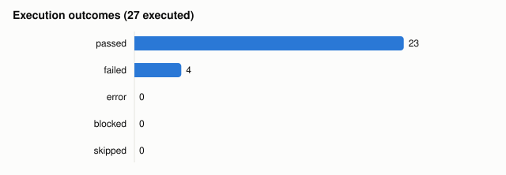
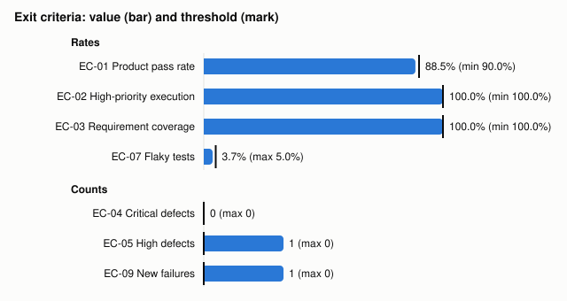
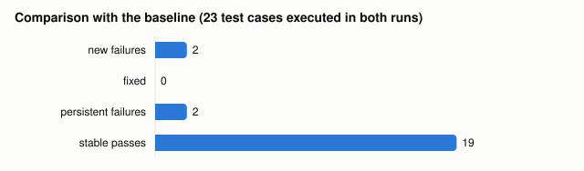

# Test completion report: shop-api

> **Prototype filled by hand.** This report was not generated by RetroAgent. It is the template `test-completion-report.md` filled with the results of the reference scenario of `shop-api` (see `ORACLE.md`), which were obtained by running the project as the test runner will. It shows what RetroAgent must produce for that scenario. The agent sections were also written by hand, as an example of what the model writes.

| Field | Value |
|---|---|
| Report | RPT-0001 |
| Generated | 2026-11-15T22:30-05:00 |
| Baseline | `v1.0` (`c7d45ad`) |
| Candidate | `v1.1` (`46a5ef0`) |
| Evaluated run | RUN-0004 |
| Baseline run | RUN-0003 |
| Model | none (written by hand) |
| RetroAgent | prototype |

## 1. Executive summary

**Release decision: `do_not_release`**

| Exit criteria | Count |
|---|---|
| Met | 6 |
| Not met | 3 |
| Not evaluable | 0 |

Reasons for the decision:

- EC-01 Product pass rate: threshold at least 90.0%, value 88.5%.
- EC-05 High defects: threshold at most 0, value 1.
- EC-09 New failures: threshold at most 0, value 1.

> **Agent analysis** · written by hand for this prototype, not computed.
>
> Version `v1.1` must not be released. One test case that passed against `v1.0` fails against `v1.1` without a documented reason: TC-020 shows that shipping is no longer charged when a coupon brings the subtotal under 100.00, which contradicts REQ-005. It is registered as DEF-001 with severity `high`. The decision does not depend on that severity: the new failure alone blocks release (EC-09), and the product pass rate is under its threshold (EC-01).
>
> Recommended actions, in order: fix DEF-001 in `src/shop/pricing.py` and run the suite again; update TC-014, which still checks the rule that REQ-004 replaced in `v1.1`; review the flaky test TC-011; decide what to do with TC-022, which already failed against `v1.0`; implement TC-028.

## 2. Summary of testing performed

| Measure | Value |
|---|---|
| Planned test cases | 28 |
| Executed | 27 |
| Passed | 23 |
| Failed | 4 |
| Error | 0 |
| Blocked | 0 |
| Skipped | 0 |
| Run duration | 3.4 s |
| Test time | 0.0 s |

> **Agent analysis** · written by hand for this prototype, not computed.
>
> The change between `v1.0` and `v1.1` lets two coupons be combined (REQ-004) and adds the order history (REQ-008). It modifies the modules that compute discounts and totals and the module that holds the cart. The suite contains the 26 tests of the project and two test cases designed for REQ-002, which had no test. Of the 27 test cases executed against `v1.1`, 23 passed and 4 failed. The four failures have four different explanations, given in sections 6 to 8: one regression, one test that checks a rule that changed, one flaky test and one failure that the baseline already had.

## 3. Scope: planned versus actual

| Metric | Value |
|---|---|
| Planned | 28 |
| Implemented | 27 |
| Implementation rate | 96.4% |
| Designed only | 1 |
| Executed | 27 |
| Execution rate | 96.4% |

## 4. Deviations from planned testing

| Test case | Deviation | Reason |
|---|---|---|
| TC-028 | Designed only | The test case was designed and never implemented, so it was not executed. |

> **Agent analysis** · written by hand for this prototype, not computed.
>
> TC-028 (an unknown product cannot be added to a cart) was designed for REQ-002 and has no test code. It was not executed, and nothing is known about that behavior in `v1.1`. REQ-002 still counts as covered because TC-027 was executed, but its error path is unverified. The deviation does not change the decision, which is already `do_not_release`.

## 5. Test completion evaluation

| ID | Criterion | Threshold | Value | State | Blocking |
|---|---|---|---|---|---|
| EC-01 | Product pass rate | at least 90.0% | 88.5% | `not_met` | Yes |
| EC-02 | High-priority execution | at least 100.0% | 100.0% | `met` | Yes |
| EC-03 | Requirement coverage | at least 100.0% | 100.0% | `met` | No |
| EC-04 | Critical defects | at most 0 | 0 | `met` | Yes |
| EC-05 | High defects | at most 0 | 1 | `not_met` | Yes |
| EC-06 | Medium defects | none | 0 | `met` | No |
| EC-07 | Flaky tests | at most 5.0% | 3.7% | `met` | No |
| EC-08 | Failures triaged | none | 4 of 4 triaged, 1 of 1 regressions linked to a defect | `met` | Yes |
| EC-09 | New failures | at most 0 | 1 | `not_met` | Yes |

## 6. Test measures

### Results

| Metric | Value |
|---|---|
| Pass rate | 85.2% |
| Excused failures | 1 |
| Pre-existing failures | 1 |
| Product pass rate | 88.5% |
| Flaky executions | 1 |
| Flaky rate | 3.7% |

### Coverage

| Metric | Value |
|---|---|
| Impacted requirements | 7 |
| Covered requirements | 7 |
| Requirement coverage | 100.0% |
| High-priority test cases planned | 15 |
| High-priority execution rate | 100.0% |

### Comparison with the baseline

| Metric | Value |
|---|---|
| New failures | 2 |
| New failures not excused | 1 |
| Fixed | 0 |
| Persistent failures | 2 |
| Stable passes | 19 |
| Not comparable | 4 |

### Selection quality

Informative only; not part of the exit criteria.

| Metric | Value |
|---|---|
| Revealing test cases | 2 |
| Selection inclusiveness | 100.0% |
| Selection precision | 0.0% |

## 7. Defects

| Metric | Value |
|---|---|
| Found in this run | 1 |
| Closed | 0 |
| Open, critical | 0 |
| Open, high | 1 |
| Open, medium | 0 |
| Open, low | 0 |

| ID | Severity | Title | Test cases |
|---|---|---|---|
| DEF-001 | `high` | Shipping is not charged when a coupon brings the subtotal under 100.00 | TC-020 |

## 8. Items requiring review

| Test case | Reason for review | Detail |
|---|---|---|
| TC-014 | Excused: `expected_change` | REQ-004 has the entry "Changed: v1.1 - Two different coupons can be combined". The test still expects a second coupon to be rejected. The test must be updated. |
| TC-011 | Flaky | Attempts: failed, passed, passed. |
| TC-022 | Pre-existing failure | Failed against the baseline in RUN-0003. |

Excused failures are excluded from the product pass rate, flaky failures can reveal real faults, and pre-existing failures show that the baseline was already failing. All of them are listed so that they can be reviewed.

## 9. Residual risks

| ID | Risk | Level | Requirements |
|---|---|---|---|
| RSK-001 | Totals are computed in a new order in `src/shop/pricing.py`; shipping and tax may be computed on the wrong amount. | `high` | REQ-003, REQ-005, REQ-007 |
| RSK-002 | Coupon rules changed in `src/shop/discounts.py`; combinations of coupons may give a wrong discount. | `high` | REQ-004 |
| RSK-003 | `src/shop/cart.py` changed and its stock check had no test before this cycle. | `medium` | REQ-002 |
| RSK-004 | Orders are now kept in memory by `src/shop/store.py`; checkout has a new side effect. | `low` | REQ-006, REQ-008 |

> **Agent analysis** · written by hand for this prototype, not computed.
>
> RSK-001 materialized: it is DEF-001. Until it is fixed, customers with a coupon can receive free shipping they are not entitled to. RSK-002 remains partly open: the two new coupon tests passed, but TC-014 no longer verifies anything valid, so the rejection of a third coupon and of a repeated coupon rests on one test. RSK-003 is reduced by TC-027 and remains for the error path of TC-028. RSK-004 showed no failure. Two risks are outside this change: the tax rounding of REQ-007 (TC-022) and the order of search results on a new installation (TC-011) fail in both versions.

## 10. Limitations

- The number of flaky executions is a lower bound: a few reruns find only part of the flakiness.
- Code coverage is not measured.

> **Agent analysis** · written by hand for this prototype, not computed.
>
> The suite ran every test of the project, so no failure was missed by selection; the selection precision of 0.0% says only that nothing was left out. A pass proves what the test asserts and no more: the API tests cover one path per endpoint. The four tests added in `v1.1` cannot be compared with the baseline, because they do not exist there.

## 11. Test deliverables

| Deliverable | Location |
|---|---|
| Evidence of the full run against the baseline (RUN-0001) | `.retro/runs/RUN-0001/` |
| Evidence of the full run against the candidate (RUN-0002) | `.retro/runs/RUN-0002/` |
| Evidence of the baseline run (RUN-0003) | `.retro/runs/RUN-0003/` |
| Evidence of the evaluated run (RUN-0004) | `.retro/runs/RUN-0004/` |
| Generated tests | `.retro/tests/` |
| This report | `.retro/reports/RPT-0001-completion/` |

---

Metric definitions, exit criteria and the release decision rule are described in the RetroAgent metrics reference. Computed sections are reproducible from the project memory at the generation time above.
